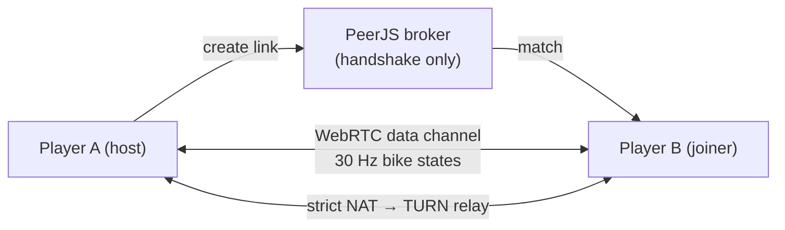

# Portfolio

A static, frontend-only personal portfolio you can **ride**: drive a light cycle across a 3D grid arena, pull up to station monuments, and read the content in terminal dialogs. A semantic, no-WebGL **Read** view carries the same content; it is the default for first visits, `prefers-reduced-motion`, and non-WebGL browsers.

> Visual style inspired by Tron: Legacy. Not affiliated with Disney.

## Features

- **Ride view**: Three.js / React Three Fiber arena (240×240) with bloom post-processing: free-roam driving, powerslide drifts, stationary burnouts, boost ribbon light walls, drift tyre marks, and a chase camera with free orbit + wheel zoom.
- **Read view**: single-column semantic HTML/CSS with a CSS-only perspective grid floor. Same station components, no Three.js loaded. Initial JS stays ≤ 120 kB gzipped before the lazy 3D chunk.
- **Six stations**: Intro, About, Skills, Experience, Projects, Links, placed as spatial monuments with radar, proximity prompts, autopilot docking, and a keyboard-scrollable inspector dialog.
- **Grid Battle**: opt-in two-player light-cycle duel over WebRTC. The PeerJS public broker is used only for the handshake; gameplay is browser-to-browser. Boost trails are solid walls, arena-wall touches score for the opponent, fuel and boosters shape the match. Everything else on the site stays 100% offline.
- **Procedural audio**: engine, boost, drift, terminals, impacts: all synthesized live via the Web Audio API. Zero audio files.
- **Static & host-neutral**: `npm run build` outputs a pure static `docs/` with relative paths and hash deep links; deploys to any static host or sub-path. Fonts self-hosted, no CDNs.
- **Accessible**: "Skip the ride" first focusable element, full keyboard play, visible ember focus rings, WCAG AA contrast.

## Grid Controls

| Action          | Desktop                          | Mobile                    |
| --------------- | -------------------------------- | ------------------------- |
| Drive / Reverse | `W` `S` or `↑` `↓`               | Left-thumb joystick       |
| Steer           | `A` `D` or `←` `→`               | Left-thumb joystick       |
| Boost (trail)   | `Shift` (hold)                   | Joystick past the top rim |
| Brake / Drift   | `Space` while steering           | Drift pedal               |
| Burnout         | `W`/`Shift` + `Space` (hold)     | Joystick up + pedal       |
| Inspect station | `Enter`                          | Tap the station prompt    |
| Orbit / Zoom    | Drag / scroll wheel (stationary) | Drag / pinch (stationary) |

In a Grid Battle the bike auto-cruises: steer, boost, and drift are the live controls.

## How Grid Battle syncs

Grid Battle duels are peer-to-peer. A public PeerJS broker is used only for the initial handshake (create link / enter code). After that, all gameplay runs over a direct browser-to-browser WebRTC data channel; no game server ever sees your inputs. Each bike broadcasts its state 30× per second, and the opponent's bike is dead-reckoned to "now" (position + velocity + measured round-trip delay), so both screens stay in agreement even on laggy links. Riders behind strict NAT fall back to a TURN relay just to establish the connection.

> **Playing from Iran?** The public signaling broker is intermittently unreachable from Iranian networks; if a battle won't start, a VPN usually fixes the handshake.

## License

All rights reserved. This repository is published as a showcase only. The code and assets are not licensed for copying, modification, or redistribution. The 3D models under `public/models/` are extracted from the defunct official Tron: Legacy website and remain the property of their respective owners and are not covered by this license. See [LICENSE](LICENSE).
